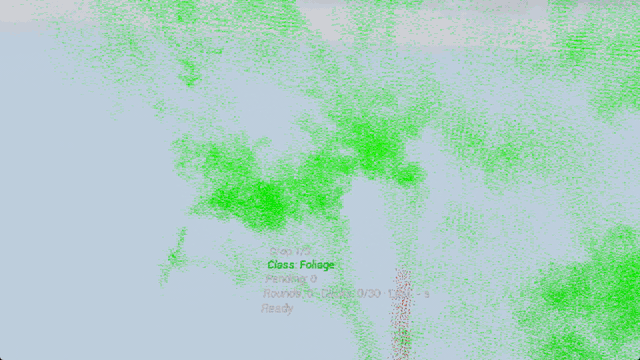

# Forestry Interactive Semantic Segmentation

Interactive semantic segmentation of forest point clouds in VR. The user clicks on wrong points in the headset, a server adapts the model to those clicks with test-time training, and the refined labels come back to the headset.

> **Work in progress.** The code is being cleaned up for release. Sections marked TODO are not written yet.

## Overview

The repository has three parts:

- `ISSR_VR/`: the Unreal Engine 5 VR client
- `ISSR_PC/`: the Python server the client connects to
- `ISSR/`: the interactive refinement (adapted from ISSR), used by the server and by the simulated user

`Pointcept/` is used to train the backbone on the forest plots.

## VR client

Start menu on the desktop. The headset has to be connected first, then fill in the server's IP address and port and press Start.

Inside VR, the right controller carries the aim ray for clicks. Clicks are shown as balls in the colour of the selected class: green for foliage, red for stem and blue for ground.

The menu is toggled with the left controller:

Controller mapping:

## Setup

TODO: Docker image, Python environment, Unreal Engine version and the LidarPointCloudFast plugin.

## Data

TODO: where the `.laz` plots go and how the train/val/test split is set.

## Training

TODO: preprocessing and training the backbone with the configs in `Pointcept/configs/forest/`.

## Running the server

TODO: starting `ISSR_PC.app` and connecting the client.

## Simulated user

TODO: running `ISSR.ISSR` on a plot and the flags behind the thesis tables.

## Acknowledgements

TODO: credit ISSR, Pointcept, ForestFormer3D and PointNet++. `LidarPointCloudFast` is derived from Epic Games' LidarPointCloud plugin.

## License

TODO
